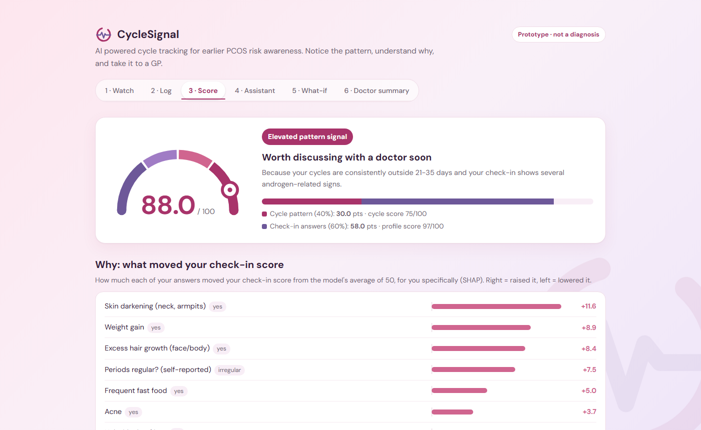
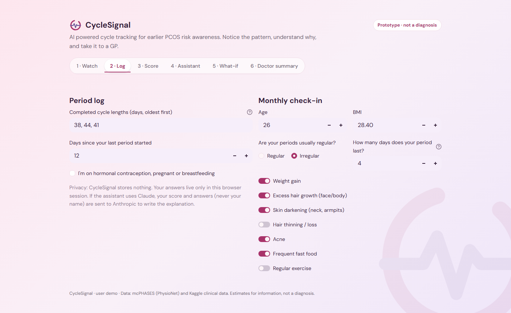
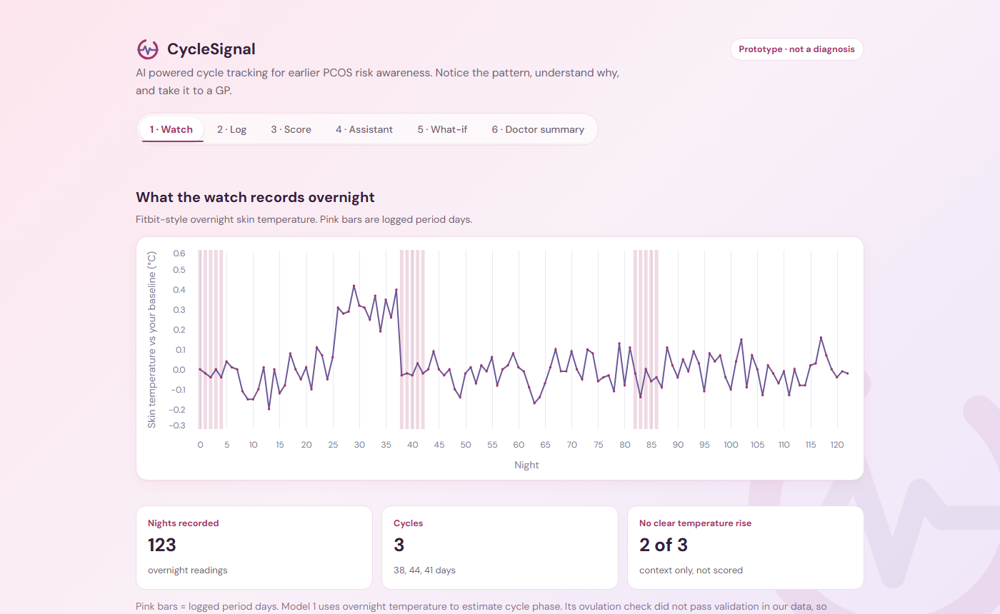
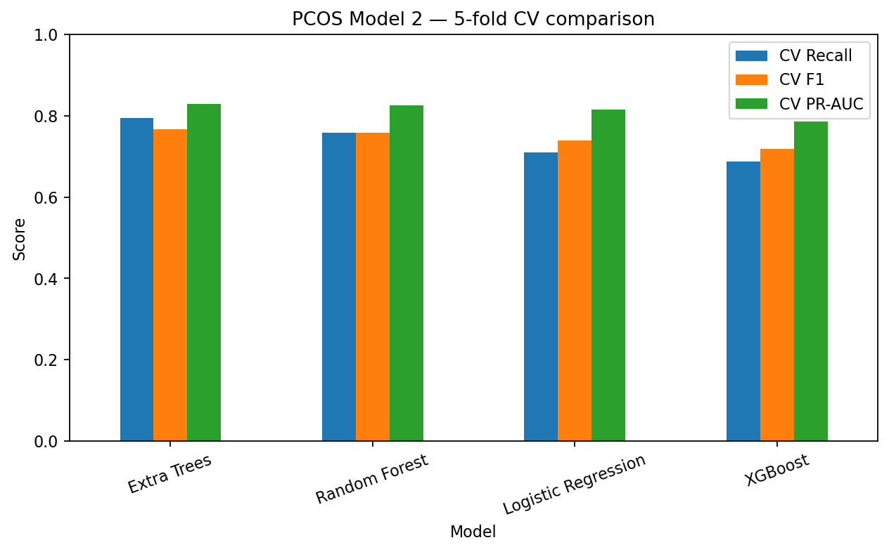
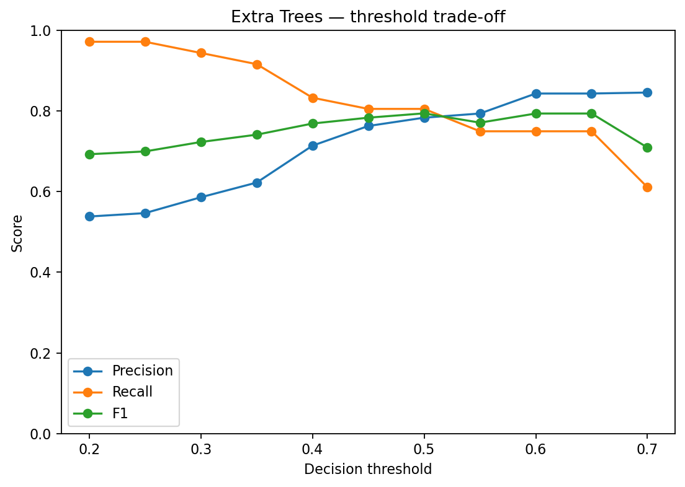
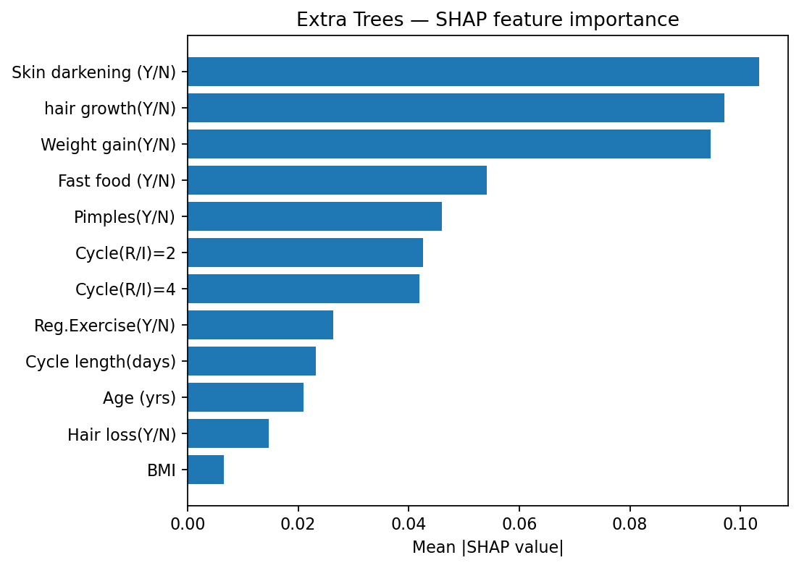
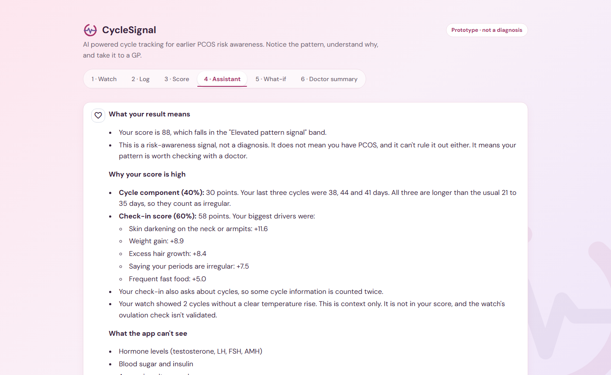
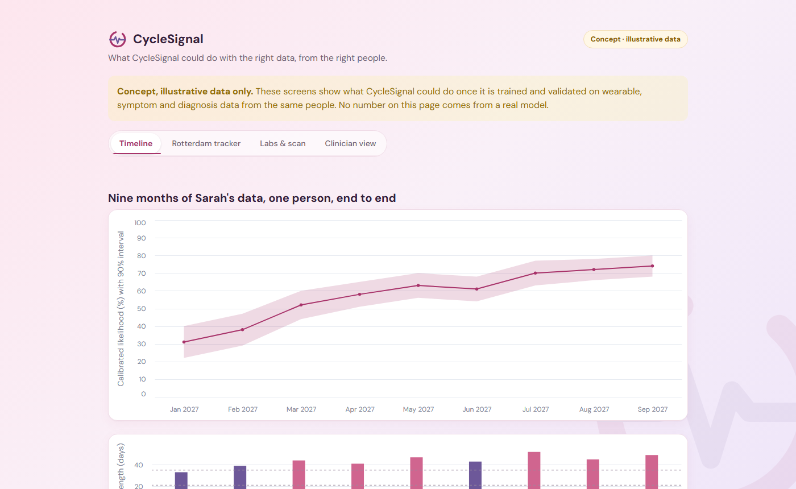

<header class="masthead">
  
Women in AI Ireland

  <h1>CycleSignal</h1>
  
AI powered cycle tracking for earlier PCOS risk awareness

  
Many women wait years for a PCOS diagnosis. CycleSignal brings together a wearable, a short monthly
  check-in and two machine learning models to spot a concerning pattern early, explain why in plain words, and suggest
  when to see a GP. It is not a diagnosis.

  

    
Contributors

  

    
EO
<b>Emma O'Connell</b><small><a href="https://www.linkedin.com/in/emma-o-connell-735681184/">LinkedIn</a><a href="https://github.com/eoc3001">GitHub</a></small>

    
AJ
<b>Anuja Thuraiyur Jayakumar</b><small><a href="https://www.linkedin.com/in/anuja-jayakumar-datascience001/">LinkedIn</a><a href="https://github.com/anujatj0011">GitHub</a></small>

    
FE
<b>Fiona Edocket</b><small><a href="https://www.linkedin.com/in/fionaedocket">LinkedIn</a><a href="https://github.com/f-ayanae">GitHub</a></small>

    
LT
<b>Ling Tsai</b><small><a href="https://www.linkedin.com/in/yltsai/">LinkedIn</a><a href="https://github.com/ling0110">GitHub</a></small>

  

  

  

    <a class="btn btn-primary" href="https://wai---group1-iwvd7wox6mmmbwhs2kxkyd.streamlit.app/">Open the app ↗</a>
    <a class="btn" href="https://github.com/eoc3001/WAI---GROUP1">Read the code</a>
    <!-- Add when the video is uploaded: <a class="btn" href="VIDEO-LINK">Watch the video</a> -->
  

</header>

<figure class="app-figure">
  

<i></i><i></i><i></i>The CycleSignal app · prototype

    

  <figcaption class="figcap"><b>The app.</b> Sarah's result after three months of logging: what the app tells her, and why.
  The rest of this article explains how we built it.</figcaption>
</figure>

<section class="band">
  
Key numbers

  

    
<b>1 in 10</b>women of reproductive age are affected by PCOS

    
<b>Up to 70%</b>of affected women are undiagnosed (WHO)

    
<b>0.92</b>ROC-AUC of our risk model on held-out patients

    
<b>541 + 42</b>clinical patients and wearable users in our data

  

</section>

<article class="prose" markdown="1">

## Why we built CycleSignal

Polycystic ovary syndrome (PCOS) affects an estimated 1 in 10 women of reproductive age, and the
World Health Organization estimates that **up to 70% of women with it are undiagnosed**.

PCOS can show up as irregular periods, weight gain, acne, extra facial or body hair, or dark patches
of skin. Each of these is easy to explain away on its own, and a GP only sees a snapshot at each
appointment, not months of cycles. That is a big part of why diagnosis is so often delayed.

We wanted to know whether everyday data, from a wearable and a few answers a person can give
herself, could help someone notice a worrying pattern sooner and bring it to a GP.

CycleSignal is the prototype we built to test that. It combines two machine learning models with
an AI assistant. The models produce a risk-awareness score, the assistant explains which of her own
answers moved it, and the app suggests a next step. It does not diagnose anything.

Health services such as the NHS and HSE now call the condition PMOS
(polyendocrine metabolic ovarian syndrome). It used to be called PCOS. Our datasets use the older
name, so we do too, and the app explains both.

## The data

No open dataset has wearable data and a PCOS diagnosis for the same people, so we used two
separate public datasets.

| | mcPHASES (PhysioNet) | PCOS dataset (Kaggle) |
|---|---|---|
| What it is | Wearable, hormone and diary data for menstrual health tracking | Clinical records of patients assessed for PCOS |
| People | 42 young adults in Canada; 20 completed a second 3-month interval | 541 patients from 10 hospitals in Kerala, India (177 with PCOS) |
| What we used | Fitbit Sense overnight temperature and resting heart rate, Mira LH/PdG hormone tests, period diary | 11 inputs a person can self-report (no lab tests, no ultrasound) |
| Used for | Model 1: cycle tracking | Model 2: PCOS risk profile |

From mcPHASES we built a daily table for each participant: 3,697 days from 42 people in the first
interval and 1,961 days from 20 people in the second.

## How it works

The watch records overnight. She logs the days of her period and answers a short check-in once a
month. Model 1 turns the period log and watch data into a cycle history, and Model 2 compares her
check-in answers with patterns learned from clinical patients. The app combines the two into one
score, and the agent layer decides how strongly to recommend a GP visit and explains its reasoning.

The monthly check-in. None of the questions need a clinic visit.

### Model 1: wearable cycle tracking

Model 1 works out cycle length and regularity from the period diary. It also estimates cycle phase
from overnight skin temperature, which rises slightly after ovulation.

- **Cycle length:** across 69 diary cycles the median was 30 days, with a range of 19 to 62.
- **Regular cycles:** we use the FIGO 2018 definition, every cycle between 24 and 38 days and
  varying by no more than 9 days.
- **Irregular-cycle flag:** follows the Rotterdam criteria, 2 of her last 3 cycles shorter than 21
  or longer than 35 days, or fewer than 8 periods a year.
- **No period for 90+ days:** always triggers "see a doctor".
- **Label check:** regular or irregular from the Mira period label matched the diary for 24 of 25
  people.

We also tried to detect whether ovulation had happened from wrist temperature, and wrote down
pass/fail criteria before testing. **It failed.** The false-alarm rate was too high, it did not
beat a simple calendar-based guess, and it gave a confident answer too rarely. Only its calibration
passed. Part of the problem was that the data had just 13 usable cycles without ovulation. So in
the app, temperature is shown as context and never raises a flag by itself.

Overnight skin temperature across three cycles. Pink bars are logged period days.

### Model 2: PCOS risk profile from self-reported answers

We trained Model 2 on the Kaggle data using only questions a person can answer without visiting a
clinic: age, BMI, whether her periods are regular, period length (days of bleeding), weight gain,
excess hair growth, skin darkening, hair loss, acne, fast food and regular exercise.

We compared four models using 5-fold cross-validation and a held-out test set of 20% of patients.

| Model | CV ROC-AUC | Test ROC-AUC | Test recall | Test precision | Test F1 |
|---|---|---|---|---|---|
| Extra Trees | 0.89 | 0.92 | 0.81 | 0.78 | 0.79 |
| Random Forest | 0.89 | 0.91 | 0.75 | 0.82 | 0.78 |
| Logistic Regression | 0.88 | 0.89 | 0.72 | 0.87 | 0.79 |
| XGBoost | 0.87 | 0.90 | 0.72 | 0.81 | 0.76 |

Cross-validated recall, F1 and PR-AUC for the four models.

We picked **Extra Trees** because it had the highest recall. In an awareness tool, missing someone who
should see a doctor costs more than an extra prompt to get checked. At the 0.5 threshold it
**caught about 8 in 10 PCOS cases** in the test set.

A lower threshold catches more cases but raises more false alarms.

According to SHAP, the inputs the model leans on most are **skin darkening, excess hair growth and
weight gain**, followed by fast food, acne and cycle regularity.

Mean absolute SHAP value for each input across the dataset.

### The combined CycleSignal score

The score runs from 0 to 100. **Forty percent** of it comes from the cycle pattern (Model 1) and **sixty
percent** from the check-in profile (Model 2). Each score falls into one of four bands: Low, Some
patterns to monitor, Increased, or Elevated pattern signal. We chose the weights and bands
ourselves. They have **not been clinically validated**, and the app says so.

## The agent: explaining the score

The agent layer sits between the score and the person reading it, and has three jobs.

#### Deciding the level

A diagnosis under the Rotterdam criteria needs evidence in 2 of 3 areas, and the app can see two of
them: irregular ovulation, from the period log, and androgen-related signs, from Model 2. Model 2
also uses her cycle answers, so we check the androgen flag with those answers set to "regular".
That way cycle evidence isn't counted twice. The result is one of a few levels, from "nothing to
act on" up to "worth discussing with a doctor soon". No period for 90 days or more always gives
"see a doctor".

#### Explaining her score

Per-person SHAP values show how much each of her answers moved the score, for example skin
darkening adding 12 points. Sometimes the training data pushes an answer the wrong way: for some
users, reporting acne lowers the score. The app fades those rows and labels them as data quirks,
not health advice.

#### Answering questions

The assistant runs on Claude (Anthropic) and only sees the numbers our models produce. Its
instructions say never to diagnose, always to mention what the app can't see (hormone levels, blood
sugar, an ultrasound), and to end with a concrete next step. Under each answer the app adds a short
reading list from the WHO, HSE, NHS and Jean Hailes, picked to match her symptoms. If no API key is
set, a rule-based assistant gives the same facts offline.

The assistant explains Sarah's result from her own numbers and suggests a next step.

## The app

The prototype is a Streamlit app with two fictional demo users. Sarah has long, irregular cycles
and several symptoms. Aoife has regular cycles and few symptoms.

| Demo user | Cycle history | Score | Band | Assistant's advice |
|---|---|---|---|---|
| Sarah, day 1 | Not enough yet | 66.0 | Increased pattern signal | Keep logging; mention it to your GP if it continues |
| Sarah, after 3 months | 38, 44 and 41 days | 88.0 | Elevated pattern signal | Worth discussing with a doctor soon |
| Aoife | 28, 30 and 29 days | 19.7 | Low pattern signal | Nothing to act on; a low score can't rule PCOS out |

There is also a what-if view that shows which answers move the score, a doctor summary she can
download and take to an appointment, and a pause on cycle checks during hormonal contraception,
pregnancy or breastfeeding.

The app stores nothing, and the API key is kept in server secrets. The hosted demo needs a password
and limits how many questions each visitor can ask. In our tests, the assistant refused requests to
change its rules or reveal its instructions.

### The vision

Right now our two models learn from different people in different countries. The next step needs
wearable data, symptoms and a confirmed diagnosis from the same women, followed for 6 to 12
months. With that, the app could show one person's whole history, confirm ovulation with a
validated detector, give a calibrated likelihood with an uncertainty range, take lab results, and
share a summary with her doctor.

Concept screens. The app labels this data as illustrative.

## Limitations

- The cycle data (Canada) and clinical data (India) come from different people, so the combined
  score has **not been validated on anyone**.
- Model 2 learned from one hospital network in Kerala, India, and may not generalise to other
  populations.
- No mcPHASES participant met the irregular-cycle criteria, so we could not test that flag on real
  PCOS cycles.
- Wrist-temperature ovulation detection did not pass our checks.
- CycleSignal is a student prototype, not a medical device.

## What we learned

Our best model reached a test ROC-AUC of 0.92, but most of our design time went on deciding what
the app should not claim. Temperature stays as context. Data quirks are labelled. The app never
diagnoses, and it suggests a GP visit when the pattern calls for one. Along the way we combined
wearable signal processing, tabular machine learning, SHAP explanations and an LLM assistant with
guardrails in one prototype. The limitations above are our list of what would have to change before
anyone could rely on it.

## References

<ol class="refs">
<li>World Health Organization. <a href="https://www.who.int/news-room/fact-sheets/detail/polycystic-ovary-syndrome">Polycystic ovary syndrome: fact sheet</a>.</li>
<li>Lin B, Li JY, Kalani K, Truong K, Mariakakis A. <a href="https://doi.org/10.13026/zx6a-2c81">mcPHASES: a dataset of physiological, hormonal, and self-reported events and symptoms for menstrual health tracking with wearables</a> (v1.0.0). PhysioNet, 2025.</li>
<li>Kottarathil P. <a href="https://www.kaggle.com/datasets/prasoonkottarathil/polycystic-ovary-syndrome-pcos/data">Polycystic ovary syndrome (PCOS) dataset</a>. Kaggle.</li>
<li>Teede HJ et al. <a href="https://doi.org/10.1210/clinem/dgad463">Recommendations from the 2023 International Evidence-based Guideline for the Assessment and Management of Polycystic Ovary Syndrome</a>. J Clin Endocrinol Metab, 2023.</li>
<li>Rotterdam ESHRE/ASRM-Sponsored PCOS Consensus Workshop Group. <a href="https://doi.org/10.1016/j.fertnstert.2003.10.004">Revised 2003 consensus on diagnostic criteria and long-term health risks related to PCOS</a>. Fertil Steril, 2004.</li>
<li>HSE Ireland. <a href="https://www2.hse.ie/conditions/polycystic-ovary-syndrome/">Polyendocrine metabolic ovarian syndrome (PMOS)</a>.</li>
<li>Lundberg SM, Lee S-I. <a href="https://arxiv.org/abs/1705.07874">A unified approach to interpreting model predictions (SHAP)</a>. NeurIPS, 2017.</li>
</ol>

</article>
